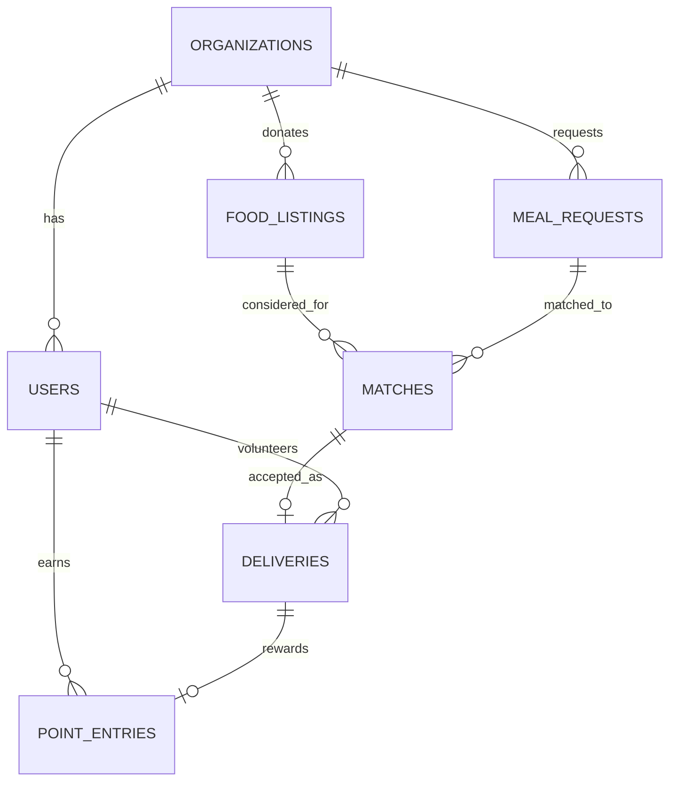

# FoodBridge

FoodBridge connects food donors, recipient organizations, and field volunteers through a shared rescue network. This repository contains a responsive React PWA-style web client and a FastAPI service. The UI adapts to four roles; the API enforces authorization independently of the selected dashboard.

## What is included

- **Role-based web dashboards:** admin, donor, recipient, and volunteer dashboard views; responsive layout; listing and meal-request forms; donor photo suggestions; match accept/decline; account registration and sign-in.
- **Live map:** Leaflet/OpenStreetMap map with donor, recipient, and en-route volunteer markers, route lines, and WebSocket-triggered refreshes. The logged-out preview uses illustrative sample markers; authenticated users get locations from the API.
- **FastAPI backend:** signed bearer tokens, Argon2 password hashes, role checks, organization verification gates, SQLite/WAL or Supabase PostgreSQL persistence, food/request/match/delivery workflows, proof-of-delivery upload, volunteer points, admin metrics, and WebSockets.
- **Local AI:** Ollama text explanations for ranked matches and a local vision-model endpoint for photo category/portion suggestions. The matching score remains deterministic and usable if text generation is offline; vision analysis reports an explicit service error when Ollama is unavailable.
- **Schema:** SQLAlchemy models provide the initial SQLite schema. `Base.metadata.create_all` initializes a new database; use a migration system before evolving a deployed schema.

## Start the application

Requirements: Node.js 22+, Python 3.11+, and (for AI features) Ollama.

1. Install frontend packages and start Vite:

   ```sh
   npm install
   npm run dev
   ```

2. Set up and start the backend in another terminal:

   ```sh
   cd backend
   python3 -m venv .venv
   source .venv/bin/activate
   pip install -r requirements.txt
   cp .env.example .env
   python -m app.cli create-admin
   uvicorn app.main:app --reload
   ```

3. Optional local AI models:

   ```sh
   ollama pull llama3:8b
   ollama pull moondream
   ```

   Ollama should be available at `http://localhost:11434`. Set `OLLAMA_TEXT_MODEL` or `OLLAMA_VISION_MODEL` in `backend/.env` to match models already installed on your machine.

The frontend is served at `http://localhost:5173`; API docs are at `http://localhost:8000/docs`. SQLite is stored in `backend/foodbridge.db`. `SECRET_KEY` is randomly generated per process when omitted; set a stable, private value in `.env` before using persistent accounts or multiple workers. Never commit `.env` or use development secrets in production.

## Connect Supabase Postgres

The browser app continues to call FastAPI; database credentials stay in the backend and are never exposed to the frontend.

1. In Supabase, open **Project → Connect** and copy a PostgreSQL connection URI. Prefer the **Session pooler** URI when a direct connection is unavailable on your network. Keep the database password private.
2. Set `DATABASE_URL` in `backend/.env`, replacing the local SQLite URL with the Supabase URI. The backend accepts Supabase's `postgresql://` URI and selects the `psycopg` driver automatically. Supabase connections use SSL; the transaction pooler also disables prepared statement caching.
3. Keep the URI quoted if it contains shell-significant characters; percent-encode reserved characters in the username/password. Do not commit `backend/.env`.
4. Restart the backend. On first startup, SQLAlchemy creates the FoodBridge tables in the configured database. Existing SQLite data is not automatically copied; export and migrate it separately if needed.

Install the PostgreSQL driver with `pip install -r requirements.txt` after updating or creating the backend environment. To return to local development, set `DATABASE_URL=sqlite:///./foodbridge.db`.

## Android app

FoodBridge includes a Capacitor Android project which packages the responsive web app in a native Android application shell:

```sh
npm run android:sync
cd android
./gradlew assembleDebug
```

The installable debug APK is written to `android/app/build/outputs/apk/debug/app-debug.apk`. Android Studio is optional for building from the command line, but a compatible Android SDK and Java 21 must be installed.

GitHub Actions builds this APK on pushes, pull requests, and manual runs. Push a version tag to also create a prerelease with the APK attached:

```sh
git tag v0.1.1
git push origin v0.1.1
```

The artifact is debug-signed for sideloading and testing; it is not signed for Google Play. A production Play Store release needs a privately managed signing key and protected GitHub Actions secrets. Set the repository Actions variable `FOODBRIDGE_API_BASE` to the deployed HTTPS API origin (without `/api`) when building an app connected to a hosted backend. Never put database credentials or private keys in the frontend or repository.

## Account and verification flow

- Use **Create an account** from the sign-in dialog. Donor and recipient registrations create organizations with `pending` verification; volunteers can start after registration.
- Sign in with the admin account created by the CLI and review `GET /api/admin/organizations/pending`; approve via `POST /api/admin/organizations/{id}/verify`.
- Verified organizations can create donor listings or recipient meal requests. Admin accounts cannot be created through public registration.
- Admin role access is provisioned out-of-band with the CLI.

## API outline

| Area | Routes |
|---|---|
| Auth | `POST /api/auth/register`, `POST /api/auth/login`, `GET /api/auth/me` |
| Food and needs | `GET/POST /api/listings`, `POST /api/requests` |
| Matching | `GET /api/match/prioritize`, `POST /api/matches/accept` |
| Delivery | `GET /api/deliveries`, `POST /api/deliveries/{id}/claim`, `/cancel`, `/proof`, `/complete`, `PATCH /api/deliveries/{id}/location` |
| Network / AI | `GET /api/network/locations`, `POST /api/ai/analyze-image`, `WS /ws/updates?token=<access-token>` |
| Admin / points | `GET /api/admin/organizations/pending`, `POST /api/admin/organizations/{id}/verify`, `GET /api/admin/metrics`, `PATCH /api/admin/matches/{id}/priority`, `POST /api/admin/deliveries/{id}/assign`, `POST /api/admin/listings/{id}/safety-reject`, `GET /api/volunteers/me/points` |

`POST /api/deliveries/{id}/proof` accepts a JPEG, PNG, or WebP multipart field named `image`, plus `latitude` and `longitude`. Images are size-limited and saved under the configured local upload directory. Secure that directory and define a retention policy before production use.

## Data model



Organizations distinguish donor/recipient kind and pending/verified status. Listings store preparation, pickup deadline, packaging, storage, allergens, portions, safety confirmation, and optional coordinates. Meal requests store quantity, dietary restrictions, and cutoff. Matches persist score, explanation, and acceptance status. Deliveries track volunteer, live coordinates, proof metadata, and completion; point entries record earned volunteer rewards.

## Current boundaries

- The Android application is a Capacitor wrapper around the responsive web client. Play Store signing, navigation/maps API integrations, and live backend hosting require deployment configuration.
- Map tiles use OpenStreetMap. Turn-by-turn navigation, push notifications, coupon redemption, routing/ETA, organization geocoding, and district-specific filters need production integrations and operational data.
- Organization coordinates can be added to the `organizations` rows; the API intentionally does not invent geolocation. Configure HTTPS, rate limits, email verification, password recovery, backup/migrations, image retention, and audit logging before real-world deployment.
- AI output is advisory only. Donors must review and correct image suggestions before publishing; the deterministic match score and user decisions remain authoritative.
